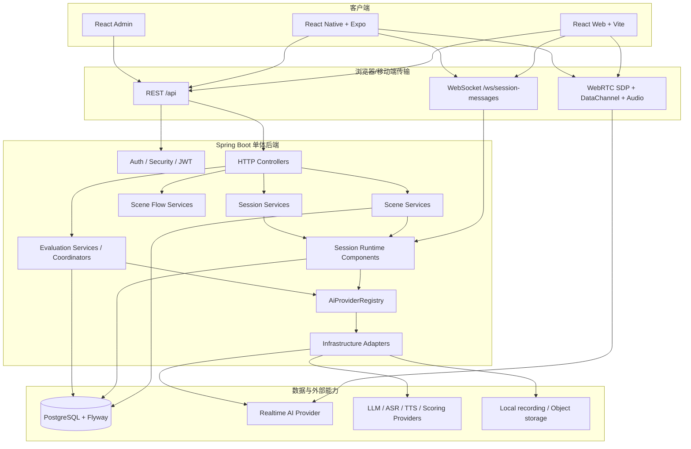
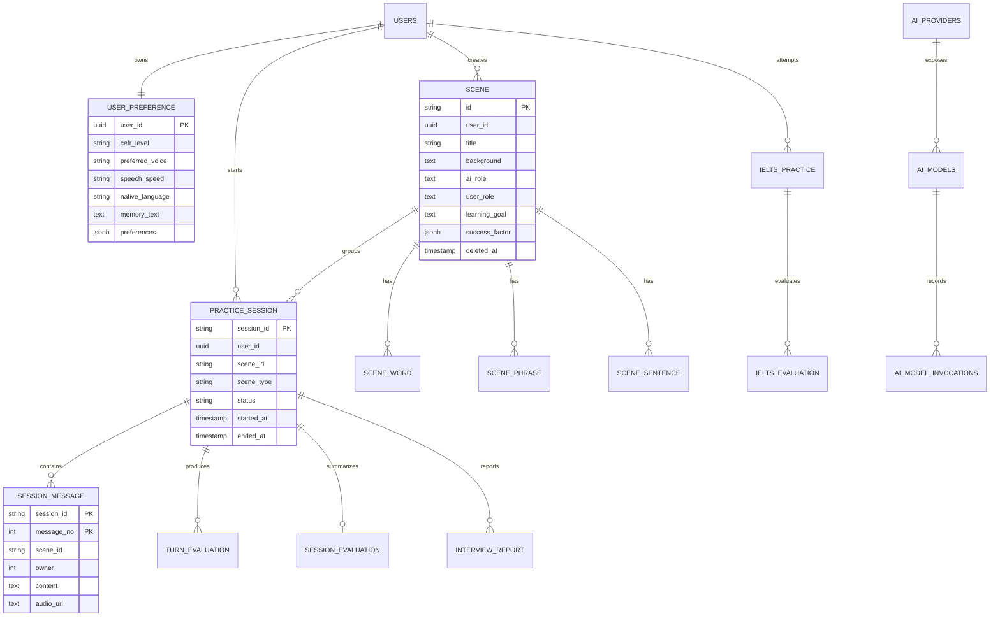
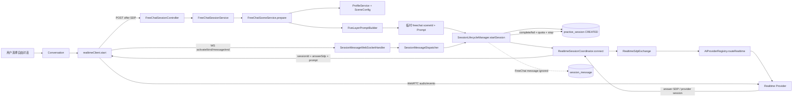
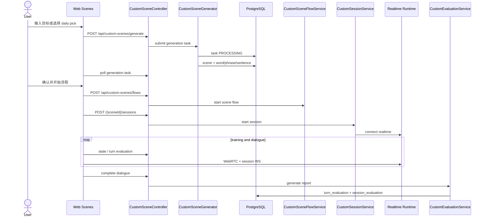
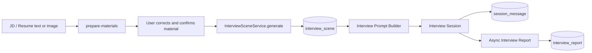
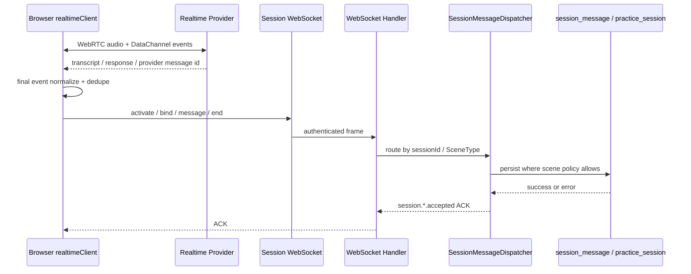

# UniSpeaking 现有架构梳理

> 文档性质：现状架构基线，只描述当前代码已经存在的边界、职责和数据流，不把目标架构提前写成既成事实。
>
> 代码基线：`backend/unispeaking-server`、`frontend/web`、`frontend/mobile`、`deploy`。
>
> 术语说明：用户提到的“统一的绘画层”本文按“统一对话/会话层”理解；当前代码没有独立的绘画业务层。用户提到的“Sync 层”也没有一个名为 Sync 的通用服务，现状中的同步语义由 WebRTC DataChannel、WebSocket ACK、Session Dispatcher、ActiveSessionRegistry 和数据库事实表共同完成。

## 1. 现状结论

UniSpeaking 当前是一个“多场景、统一 AI 能力、统一会话运行时、场景专用流程和评价”的单体后端加多端前端系统。它并不是每个页面各自实现一套语音通话：FreeChat、Custom、IELTS 和 Interview 都复用实时连接、会话生命周期、供应商路由、数据库会话事实和部分评价基础设施；差异集中在场景准备、阶段状态机、题目规则和报告生成。

当前最重要的边界如下：

| 边界 | 当前真实实现 | 主要职责 |
|---|---|---|
| Scene Preparation | 各场景具体 `*SceneService` | 校验身份和资源，准备场景资产、Prompt、角色和上下文 |
| Scene Flow | `SceneFlowService` 及 Custom/IELTS 子类 | 管理需要阶段推进的业务流程 |
| Session Runtime | `SessionLifecycleManager`、`ActiveSessionRegistry`、各场景 Session Service | 创建、激活、绑定供应商会话、接收消息、结束、额度结算 |
| Realtime Adapter | `RealtimeSessionCoordinator`、`RealtimeSdpExchange`、`RealtimeSessionTerminator` | WebRTC SDP、供应商实时会话、停止和追踪 |
| AI Gateway | `AiProviderRegistry`、`AiCapability`、各 Provider | REALTIME、LLM、SCORING、TTS、TRANSCRIPTION 路由、故障转移和计量 |
| Evaluation | 各场景 Evaluation Service、Processor、Coordinator | 逐轮评估、发音评估、报告、IELTS 聚合、面试报告 |
| Persistence | Repository + MyBatis-Plus + PostgreSQL/Flyway | 业务事实、场景、会话、消息、评分和任务状态 |
| UI Transport | `apiClient.js`、`realtimeClient.js`、自定义 `router.js` | REST、WebSocket、WebRTC、刷新和前端页面状态 |

当前系统的主要事实是：

1. `SceneType` 已经包含 `FREE_CHAT`、`CUSTOM_SCENE`、`IELTS_SCENE`、`INTERVIEW_SCENE`。
2. `practice_session` 是跨场景的统一练习会话事实表。
3. FreeChat 会创建临时 `freechat_...` 场景 ID 和 Prompt，但没有持久化的场景定义。
4. `scene` 表当前主要保存用户创建的 Custom 场景，约束为 `custom_...` ID。
5. FreeChat 的 `SessionLifecycleManager.addMessage` 明确跳过 `session_message` 持久化，因此当前 FreeChat 没有完整逐轮历史和报告事实。
6. 用户长期 `memory_text` 是用户主动维护的个人档案，不是自动会话摘要；当前没有自动记忆写回。
7. 前端有 IELTS、Interview 独立路由，但 AppShell 侧栏仍把它们隐藏在“场景”相关入口中。
8. 当前没有通用离线 Sync、Outbox、IndexedDB 或 `/api/sync`。

## 2. 技术与部署拓扑



### 2.1 后端依赖方向

```text
Controller / WebSocket
        |
        v
具体业务 Service
        |
        +--> Component / Domain DTO / Policy
        +--> Provider / Registry
        +--> Repository
                    |
                    v
             Infrastructure
                    |
                    +--> PostgreSQL / Flyway
                    +--> AI 厂商
                    +--> 录音与对象存储
```

规则由 `CLAUDE.md` 固化：Controller 不直接访问 Mapper；Service 不依赖数据库 Entity 或厂商 SDK；Repository 是业务访问数据库的唯一入口；Provider 实现和 API Key 留在 infrastructure；Component 不能成为跨重启业务真相。

## 3. 场景层：每类业务负责什么

### 3.1 FreeChat

FreeChat 是无阶段的开放实时对话。`FreeChatSceneService.prepare` 的实际顺序是：

```text
AuthService.requireUserId
  -> ProfileService.getProfile
  -> SceneRepository.findByType(FREE_CHAT)
  -> FiveLayerPromptBuilder.compose
  -> 生成临时 freechat_... sceneId + systemPrompt
```

它读取用户 CEFR、音色、语速、母语、`memory_text` 和偏好，再使用五层 Prompt：

```text
L1 Base Duty             基础教练职责
L2 Coach Voice           教练人格与音色
L3 Difficulty + Speed    学习水平与语速
L4 Learner Memory        用户主动维护的长期资料
L5 Open Conversation     当前自由对话上下文
```

FreeChat 不创建 Custom 词汇资产，也没有 `SceneFlowService`。`FreeChatSessionService` 随后调用统一 Session Runtime，再由 Realtime Coordinator 接通 WebRTC。

### 3.2 Custom 场景

Custom 场景由用户输入或 daily pick 触发异步生成：

```text
用户输入 / daily pick
  -> CustomSceneController
  -> CustomSceneService
  -> CustomSceneGenerator + AiProviderRegistry(LLM)
  -> custom_scene_generation_task
  -> scene + scene_word + scene_phrase + scene_sentence
  -> FiveLayerPromptBuilder
```

Custom 的场景 Flow 为：

```text
WORD -> PHRASE -> SENTENCE -> DIALOGUE -> COMPLETED
```

词、词组、句子训练和对话使用同一个 `sceneId`，但对话会产生独立 `sessionId`。对话结束后，Custom Evaluation Service 可以从消息和音频证据生成逐轮评价与报告；学习资产由场景快照和报告聚合。

### 3.3 IELTS

IELTS 具有独立题库、训练设置、Part 流程、逐轮评价、Part 评价和完整模考评价：

```text
settings / topics / training
  -> generate ieltsId
  -> create flow
  -> start Part session
  -> realtime conversation
  -> turn evaluation + state transition
  -> async evaluation task
  -> Part report / mock overall report / history / trends
```

完整模考的阶段为：

```text
PART1 -> PART2 -> PART3 -> COMPLETED
```

IELTS 的 Part 2 还有自己的准备时间、提示卡和状态机。IELTS 不应被 Agent 的通用追问策略替代；它应继续保留严格题目顺序和评分规则。

### 3.4 Interview

Interview 先处理 JD、简历或图片材料，再生成面试场景：

```text
prepare-materials
  -> OCR / 文本抽取 / 脱敏 / 用户确认
  -> InterviewSceneService.generate
  -> interview_scene
  -> InterviewPromptBuilder
  -> InterviewSessionService
  -> session_message + turn evidence
  -> async InterviewReport
```

Interview 的业务差异在材料上下文、岗位目标、难度、追问主题和五维报告；它仍复用统一 Session、Realtime、AI Provider 和消息证据链。

## 4. Scene、Session、Flow、Evaluation 的边界

### 4.1 Scene Preparation

Scene Service 负责“练什么”：

- 校验登录用户、资源归属和业务权限；
- 读取或生成场景定义、题目、学习目标和角色；
- 选择音色、模型路由和 Prompt；
- 保存需要持久化的场景资产；
- 返回 `sceneId`、Prompt 和场景上下文。

Scene Service 不负责创建 `sessionId`、WebRTC SDP、WebSocket 消息、会话额度结算和报告生成。

### 4.2 Scene Flow

`SceneFlowService<S>` 是当前存在的具体公共父类，提供 `start/current/next/isCompleted/clear`。Custom 和 IELTS 子类实现阶段规则；FreeChat 没有 Flow。

当前实现的一个重要限制是：Flow 状态主要在 JVM 的 `ConcurrentHashMap` 中，数据库保存场景和会话事实，但不是完整可恢复的工作流快照。服务重启后，若没有从数据库重建，进程内阶段缓存会丢失。因此不能把当前 Flow 缓存描述成跨重启的唯一真相。

### 4.3 Session Runtime

当前没有一个新的通用 `SessionService` 接口；真实的统一会话能力由以下组件组成：

```text
SessionLifecycleManager
  -> ActiveSessionRegistry
  -> PracticeSessionRepository
  -> SessionMessageRepository
  -> RealtimeSessionTerminator

RealtimeSessionCoordinator
  -> RealtimeSdpExchange
  -> AiProviderRegistry.routeRealtime
  -> Provider session bind / metadata

SessionMessageDispatcher
  -> FreeChatSessionService
  -> CustomSessionService
  -> IeltsSessionService
  -> InterviewSessionService
```

Session 负责“这一场练习发生了什么”：生成 `sessionId`、登记 `practice_session`、绑定场景和用户、处理额度、绑定外部 provider session、接收消息、终止实时会话并更新终态。

### 4.4 Evaluation

Evaluation 负责“练得怎么样”：

- 逐轮对话反馈；
- 文本、ASR 和发音证据的评估；
- Custom 对话报告；
- IELTS Part 和完整模考报告；
- Interview 五维报告。

评价不能反向负责 Session 生命周期，也不能把模型返回未经校验地写入长期画像。

## 5. AI 统一层

### 5.1 能力模型

`AiCapability` 当前包含：

```text
REALTIME
LLM
SCORING
TTS
TRANSCRIPTION
```

`AiProviderRegistry` 根据能力、模型、Provider、route key 和用户/会话上下文执行调用。它统一处理：

- 默认模型和供应商路线；
- 动态数据库配置；
- Provider 和模型可用性；
- 重试和可回退错误；
- 凭证覆盖；
- `AiInvocationContext`；
- `AiInvocationLedger` 调用记录、用量和成本估算。

现有默认路由大致是：

| 能力 | 主要模型/Provider 角色 |
|---|---|
| REALTIME | 七牛 RTI / Qwen Realtime |
| LLM | 七牛 MaaS / Qwen |
| SCORING | 讯飞发音评分 |
| TTS | Qwen、阿里、MiniMax |
| TRANSCRIPTION | Qwen ASR、豆包 ASR |

业务 Service 不应直接硬编码供应商。新的 Agent 决策层也必须通过这个 Registry 调用 LLM，而不是在 Python 或 Controller 中直接保存 API Key。

### 5.2 Realtime 数据边界

当前语音音频不是由 Java 后端中转：浏览器/移动端与实时 AI Provider 通过 WebRTC 建立媒体连接，Java 负责 SDP、凭证、会话元数据、权限、业务状态和结束通知。这样可以降低后端音频带宽和延迟，但也要求客户端和 Provider 事件处理足够可靠。

## 6. 当前数据库事实模型



### 6.1 关键表语义

- `user_preference.memory_text`：用户主动维护的长期资料。它可以进入 L4 Prompt，但不能因为模型猜测就自动覆盖。
- `scene`：当前主要是 Custom 场景定义，不是一个所有场景都必须写入的总表。
- `practice_session`：跨场景的统一会话事实，允许 `scene_id` 为空，保存状态和时间。
- `session_message`：按 `session_id + message_no` 保存对话证据；owner 0/1 分别表示助手/用户。
- `custom_scene_generation_task`：异步 Custom 场景生成状态。
- IELTS/Interview 专表：保存各自领域的题目、报告、材料和统计，不能被通用 Session 表替代。
- `ai_*`：供应商、模型、调用尝试与用量的运营事实。

## 7. 当前 FreeChat 完整数据流



### 7.1 FreeChat 启动伪代码

```text
function startFreeChat(request, authenticatedUser, offerSdp):
    userId = Auth.requireUser(authenticatedUser)
    profile = ProfileService.getProfile(userId)
    config = SceneRepository.findByType(FREE_CHAT)

    prompt = FiveLayerPromptBuilder.compose(
        profile = profile,
        sceneType = FREE_CHAT,
        sceneInput = request.prompt,
        words = [], phrases = [], sentences = []
    )

    sceneId = SceneIdGenerator.generate("freechat")
    started = SessionLifecycleManager.startSession(
        userId = userId,
        sceneType = FREE_CHAT,
        sceneId = sceneId,
        stage = "DIALOGUE",
        prompt = prompt
    )

    connection = RealtimeSessionCoordinator.connect(
        sessionId = started.sessionId,
        offerSdp = offerSdp,
        requestedProvider = request.provider,
        requestedModel = request.model,
        voice = request.voice,
        prompt = prompt
    )

    return {
        sessionId: started.sessionId,
        sceneId: sceneId,
        answerSdp: connection.answerSdp,
        providerSessionId: connection.providerSessionId,
        systemPrompt: prompt
    }
```

### 7.2 当前 FreeChat 消息语义

```text
provider WebRTC event
  -> realtimeClient 解析最终 transcript
  -> providerMessageId 去重
  -> WS message frame
  -> SessionMessageWebSocketHandler
  -> SessionMessageDispatcher
  -> SessionLifecycleManager.addMessage
  -> sceneType == FREE_CHAT
  -> 记录日志并跳过 session_message
```

这意味着当前自由聊天可以实时显示，但刷新、报告、跨设备恢复和长期 Agent 记忆没有完整的数据库证据。这个行为必须在升级中显式改变，不能假设只要新增 Agent 名称就已经拥有长期对话能力。

## 8. Custom / IELTS / Interview 数据流

### 8.1 Custom



### 8.2 IELTS

```mermaid
flowchart TD
    I0[IELTS settings / target / examiner voice]
    I1[topics or training preparation]
    I2[POST /api/ielts/generate]
    I3[POST /api/ielts/flows]
    I4[POST /api/ielts/{id}/sessions]
    I5[WebRTC + WS realtime]
    I6[turn evaluation]
    I7[question / Part2 state machine]
    I8[POST evaluation task]
    I9[async evaluator]
    I10[Part report / mock overall report]
    I0 --> I1 --> I2 --> I3 --> I4 --> I5
    I5 --> I6 --> I7 --> I5
    I5 --> I8 --> I9 --> I10
```

### 8.3 Interview



## 9. 当前实时同步语义

当前“同步层”不是独立模块，而是一条跨客户端、Provider 和 Java 的协议链：



现有同步保证：

- WebSocket 身份通过认证拦截器取得；
- sessionId 必须属于当前 userId；
- 客户端按 Provider message ID 去重；
- 服务端用 `session_id + message_no` 保证消息顺序；
- `practice_session` 记录终态和时间；
- Realtime provider session 结束时 best effort stop。

现有同步没有保证：

- 断网后的离线 outbox；
- 统一事件版本号；
- 跨进程 ActiveSessionRegistry；
- FreeChat 对话历史；
- 从任意页面刷新恢复实时会话。

## 10. 前端现状

### 10.1 路由与页面

Web 使用自定义 history router，不是 React Router。主要页面有：

```text
/conversation
/scenes
/assets
/ielts
/ielts/.../session
/ielts/assets/...
/interview
/interview/scenes/{sceneId}/session
/interview/assets/...
/profile
```

AppShell 当前侧栏主要显示自由对话、场景广场、学习资产。IELTS 和 Interview 路由本身已经独立，但页面分发和返回目标仍有部分映射到 scenes，因此导航层没有体现业务独立性。

### 10.2 前端网络边界

- `infrastructure/http/apiClient.js`：唯一 REST fetch 包装、认证凭证、401 refresh 和 telemetry。
- `realtimeClient.js`：WebRTC offer、ICE、远端事件、DataChannel、Session WebSocket、ACK、去重、结束时刷新。
- `router.js`：pathname、query、popstate 和页面映射。
- `sessionStorage`：token、最近场景等短期 UI 状态；不是服务端会话真相。
- 没有 IndexedDB、离线 outbox、通用 `/api/sync` 或离线恢复引擎。

## 11. 现有架构优点与限制

### 11.1 优点

1. AI 能力已经从业务场景中抽离，供应商替换和路由切换不需要复制场景代码。
2. `practice_session` 统一了跨场景练习时间、状态和用量事实。
3. Realtime 采用浏览器直连 Provider，降低 Java 后端音频中转压力。
4. Custom、IELTS、Interview 的业务状态机和评价规则没有互相污染。
5. Prompt 五层结构已经提供了教练人格、难度、语速、用户记忆和场景上下文的组合点。
6. WebSocket 具备鉴权、归属校验、ACK 和幂等方向，为新的 Agent 会话提供基础。

### 11.2 限制

1. FreeChat 是临时场景，不能自然表达“我创建的多个长期陪练 Agent”。
2. FreeChat 消息不落库，无法支持稳定的 Agent 历史、总结、记忆候选和跨设备恢复。
3. Custom 场景广场承担了推荐、生成、学习阶段和对话入口，用户要创建一个陪练时路径偏重。
4. 左侧导航没有直接表达“Agent、英语口语、IELTS、面试”四种长期入口。
5. Flow 状态主要在进程内缓存，跨重启恢复能力有限。
6. 前端 `/conversation/:sessionId` 当前不等同于完整会话恢复链接。
7. 现有用户 `preferencesJson` 虽被读取到领域模型，但不是新的 Agent 配置存储。
8. 不存在独立的统一 Sync 层，未来若增加 Agent 消息、记忆和异步总结，需要定义事件、幂等和重试边界。

## 12. 现状到目标的约束

后续升级应保留以下稳定事实：

- 不删除 `SceneType` 现有四种类型；
- 不把 IELTS 题目状态机改成普通开放聊天；
- 不把 Interview 材料和报告规则迁移到通用 Prompt 字符串；
- 不绕过 `AiProviderRegistry` 直接在新模块保存厂商密钥；
- 不把 `ActiveSessionRegistry` 当作历史真相；
- 不把模型自动猜测写入用户长期 `memory_text`；
- 不让 Agent UI 直接调用 Repository、Provider 或数据库；
- 不在第一阶段重写 Java、WebRTC、WebSocket 和 PostgreSQL。

这些约束是下一份 Agent 升级架构的设计前提。

## 13. 代码证据索引

下表是本文件结论对应的主要实现位置。阅读源码时，先看这些入口，再向下追 Repository、Mapper 和 infrastructure 适配器。

| 结论 | 代码位置 |
|---|---|
| 后端架构规则 | `CLAUDE.md` |
| FreeChat 场景准备 | `backend/unispeaking-server/src/main/java/com/unispeaking/service/scene/FreeChatSceneService.java` |
| FreeChat Session 启动 | `backend/unispeaking-server/src/main/java/com/unispeaking/service/session/FreeChatSessionService.java` |
| Session 统一生命周期 | `backend/unispeaking-server/src/main/java/com/unispeaking/component/session/SessionLifecycleManager.java` |
| Session 按场景分发 | `backend/unispeaking-server/src/main/java/com/unispeaking/component/session/SessionMessageDispatcher.java` |
| WebSocket 帧和 ACK | `backend/unispeaking-server/src/main/java/com/unispeaking/websocket/SessionMessageWebSocketHandler.java` |
| Realtime 连接编排 | `backend/unispeaking-server/src/main/java/com/unispeaking/component/session/RealtimeSessionCoordinator.java` |
| AI 能力路由 | `backend/unispeaking-server/src/main/java/com/unispeaking/provider/AiProviderRegistry.java` |
| 五层 Prompt 组合 | `backend/unispeaking-server/src/main/java/com/unispeaking/common/prompt/FiveLayerPromptBuilder.java` |
| 场景类型和 ID 前缀 | `backend/unispeaking-server/src/main/java/com/unispeaking/domain/vo/scene/SceneType.java` |
| 基线表、约束和索引 | `backend/unispeaking-server/src/main/resources/db/migration/V1__baseline.sql` |
| 前端自定义路由 | `frontend/web/src/controller/router.js` |
| REST 统一客户端 | `frontend/web/src/infrastructure/http/apiClient.js` |
| WebRTC + Session WS 客户端 | `frontend/web/src/websocket/realtimeClient.js` |

