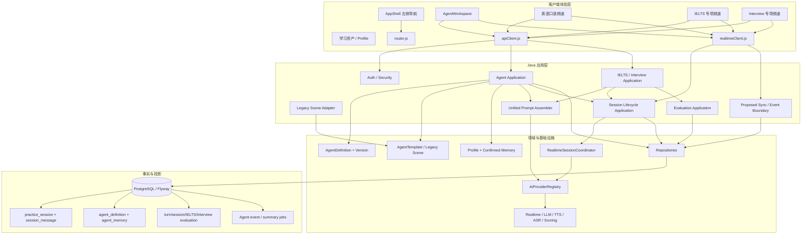
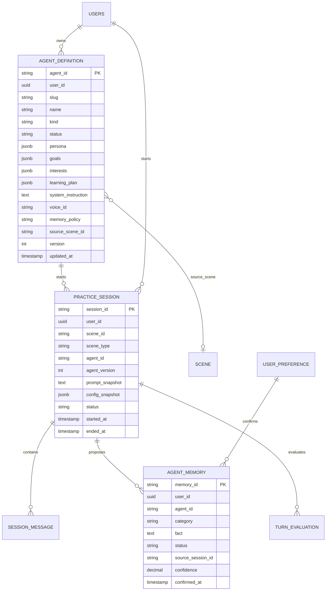
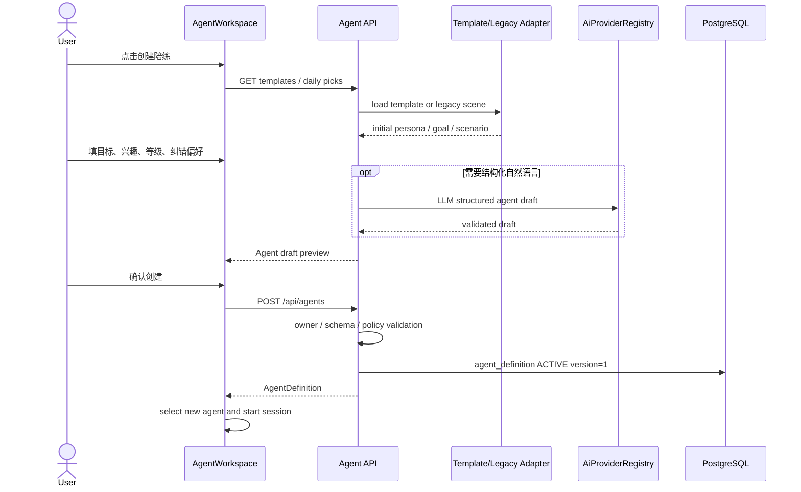
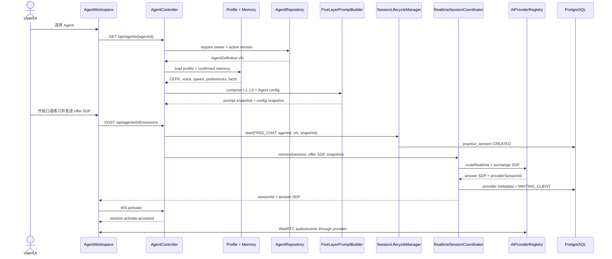
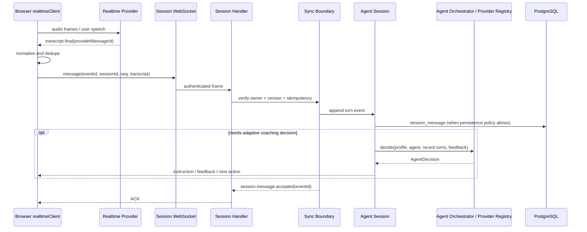
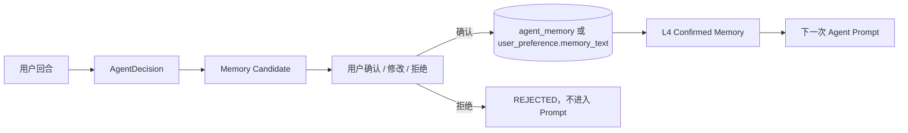
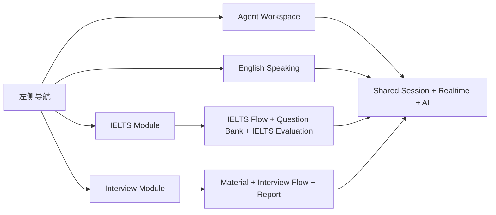
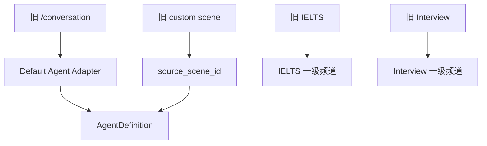

# UniSpeaking Agent 化架构升级设计

> 设计性质：纯架构设计，不改变现有代码行为。
>
> 设计目标：在现有 Scene、Session、AI Provider、Evaluation 和 PostgreSQL 架构上，增加“可创建的个性化英语口语 Agent”，把原场景广场收敛为 Agent 创建/模板能力，并把英语口语、IELTS、Interview 做成左侧一级入口。
>
> 术语说明：用户描述中的“urgent”本文统一写作 **Agent**，表示一个可长期选择、拥有稳定人格和学习目标的英语口语陪练；不是另建一个与 FreeChat、Custom、IELTS、Interview 平行的第五套实时技术栈。

## 1. 设计摘要

本方案只改变“用户如何组织和选择陪练”的上层模型，不重写实时通话底座。

```text
旧模型：
自由对话 + 场景广场 + IELTS + Interview

目标模型：
Agent 工作区
  ├── 我的口语 Agent（可自由创建、复制、归档）
  ├── 英语口语（通用口语/角色扮演，复用 Agent 会话）
  ├── IELTS（专用题库、流程、评分）
  ├── Interview（专用材料、流程、报告）
  └── 学习资产 / 个人资料（二级入口或各业务内部 Tab）
```

核心判断：

1. **Agent 是配置和工作区，不是新的实时传输层。**
2. **场景广场变成 Agent 模板和创建向导。** daily pick、用户输入和旧 Custom 场景都可以作为 Agent 的初始配置来源。
3. **英语口语是 Agent 的开放会话模式。** 它可以包含角色扮演、话题、目标、纠错方式和兴趣，不再要求用户先进入复杂的场景学习阶段。
4. **IELTS 和 Interview 独立展示，但复用既有 Session/Realtime/AI/Evaluation 基础设施。** 它们的题目和材料流程不被通用 Agent 策略替代。
5. **旧接口继续兼容。** 第一阶段不新增 `AGENT` `SceneType`，使用 `FREE_CHAT + agent_id` 的兼容方式，避免改动所有 Session Dispatcher、数据库约束和实时客户端。

## 2. 目标架构总图



### 2.1 目标层次与职责

| 层 | 新职责 | 明确不负责 |
|---|---|---|
| AppShell / Router | 左侧频道、页面进入和兼容路由 | 不拼 Prompt、不建立 WebRTC |
| AgentWorkspace | Agent 列表、创建、选择、归档、模板应用、会话入口 | 不直接操作数据库或 Provider |
| Agent Application | Agent 定义版本、权限、创建、复制、配置快照 | 不管理音频帧和 IELTS 题目状态 |
| Agent Template | 官方模板、旧 Custom Scene 适配、daily pick 适配 | 不成为新的场景运行时 |
| Prompt Assembler | L1-L5 组合、Agent 配置注入、profile/memory 过滤 | 不自动写长期记忆 |
| Session Application | `sessionId`、额度、状态、provider 绑定和结束 | 不决定 Agent 人格或 IELTS 题目 |
| Sync Boundary | WebSocket ACK、事件幂等、持久化策略、重试和投影 | 不承载 Provider 音频媒体 |
| AI Provider Registry | 统一模型能力、路由、计量、故障转移 | 不保存用户 Agent 定义 |
| Evaluation | 逐轮反馈、报告、训练进度 | 不拥有实时会话生命周期 |
| Profile / Memory | 用户资料和用户确认事实 | 不把模型摘要直接写入用户档案 |

## 3. 产品对象模型

### 3.1 Agent 的定义

Agent 是用户可选择的长期练习对象，至少包含：

```text
agentId              稳定 ID，建议 agent_ 前缀
ownerUserId          所属用户
name                 显示名称
kind                 OPEN_CHAT / ROLEPLAY / IELTS / INTERVIEW
avatar / voiceId     视觉和声音偏好
goal                 学习目标
interests            话题兴趣
level                CEFR 或当前水平
correctionPolicy     gentle / balanced / direct
persona              人格、语气、主动性、角色规则
scenario             可选的角色扮演背景
learningPlan         可选训练重点和时长
memoryPolicy         ephemeral / session / confirmed_only
modelRoute           可选 AI route key，不保存密钥
sourceSceneId        旧 Custom 场景来源，可为空
version              乐观锁版本
status               DRAFT / ACTIVE / ARCHIVED
```

Agent 配置决定“这个陪练是谁、关注什么、怎么纠错”，Session 决定“一次练习何时开始和结束”，消息决定“这一轮说了什么”，Evaluation 决定“这一轮和这一场练得如何”。四者不能合并为一个巨大的 JSON。

### 3.2 推荐数据模型

第一阶段以最少表变更为原则：新增 Agent 定义表；把 Agent 快照扩展到已有 `practice_session`，而不是马上建立大量关联表。



建议新增字段：

```sql
agent_definition(
  agent_id varchar(64) primary key,
  user_id uuid not null,
  slug varchar(80) not null,
  name varchar(120) not null,
  kind varchar(24) not null,
  status varchar(16) not null,
  persona jsonb not null default '{}',
  goals jsonb not null default '{}',
  interests jsonb not null default '[]',
  learning_plan jsonb not null default '{}',
  system_instruction text,
  voice_id varchar(64),
  memory_policy varchar(24) not null default 'CONFIRMED_ONLY',
  source_scene_id varchar(64),
  version integer not null default 1,
  created_at timestamptz not null,
  updated_at timestamptz not null,
  unique(user_id, slug)
)
```

`practice_session` 增加可空字段：

```sql
agent_id varchar(64)
agent_version integer
prompt_snapshot text
config_snapshot jsonb
```

第一阶段可以先不新增 `agent_memory`，而是只产生“待用户确认的 memory candidate”，确认后写入现有用户档案；如果需要多个 Agent 的独立记忆，再新增 `agent_memory`。无论采用哪种方案，只有 `CONFIRMED` 事实才能进入 L4 Prompt。

### 3.3 不新增的对象

第一阶段不新增：

- `AGENT` `SceneType`；
- 一套新的 WebRTC 服务；
- 一套新的 WebSocket 协议；
- 一个替代 `AiProviderRegistry` 的 Python AI Gateway；
- 一个替代 IELTS/Interview Flow 的通用状态机；
- 独立的 `agent_session_config` 表，除非快照查询和审计确实需要拆表。

原因是 Agent 首先是 `FREE_CHAT` 的可持久化配置，使用原有 `SceneType.FREE_CHAT` 可以让旧 Session Dispatcher、额度和 Realtime 路径保持不变。

## 4. 左侧导航和页面架构

### 4.1 目标导航

```text
一级入口
├── Agent / 我的陪练       /agents
├── 英语口语               /english
├── IELTS                  /ielts
├── Interview              /interview
└── 学习资产 / 个人资料    二级入口或模块内 Tab
```

“英语口语”可以是一个内置的 `OPEN_CHAT` 默认 Agent，也可以是 Agent 工作区中的快速开始模板；它不需要复制一套会话技术。

### 4.2 旧入口映射

| 旧入口 | 新入口 | 兼容策略 |
|---|---|---|
| `/conversation` | `/agents` | 旧路径保留 alias，映射默认 Agent |
| `/conversation/:sessionId` | `/agents/{agentId}/sessions/{sessionId}` | 第一阶段保留旧 URL，后续补足恢复能力 |
| `/scenes` | `/english` 或 Agent 创建向导 | 不再作为一级“场景广场”展示 |
| `/scenes/{sceneId}/...` | Agent 详情或旧 Custom 兼容页 | 保留深链接和读取，不删除旧场景 |
| `/ielts` | `/ielts` | 直接成为左侧一级入口 |
| `/interview` | `/interview` | 直接成为左侧一级入口 |
| `/assets` | 资产中心或专项内部 Tab | 不影响既有资产 API |

### 4.3 前端组件边界

```text
AppShell
  ├── SidebarNavigation
  ├── AgentWorkspace
  │     ├── AgentList
  │     ├── AgentCreateWizard
  │     ├── AgentTemplatePicker
  │     ├── AgentDetail
  │     └── AgentSessionView
  ├── EnglishSpeakingModule
  ├── IeltsTrainingCenter
  ├── InterviewModule
  └── Assets / Profile

AgentSessionView / EnglishSpeakingModule / IeltsSession / InterviewSession
  └── shared realtimeClient + apiClient + Session WS
```

AgentWorkspace 只管理 Agent 选择和配置；实时状态仍由 `realtimeClient` 管理。IELTS 和 Interview 的组件可以保持现状，只把侧栏入口和返回目标从 scenes 改成各自一级频道。

## 5. 场景广场融合为 Agent 模板

### 5.1 旧场景广场的职责拆分

旧 Scenes 页面同时承担四件事：

1. daily pick 推荐；
2. 用户输入生成 Custom Scene；
3. 词、词组、句子分阶段学习；
4. 进入实时角色扮演和评价。

目标架构将它们重命名为：

```text
Agent Template / Quick Start
  -> 选择模板或输入目标
  -> 生成 Agent 初始 persona / goal / scenario
  -> 可选生成学习内容
  -> 直接开始 Agent Session
```

原 Custom 学习链路仍可作为“英语口语 Agent 的强化训练模式”，但不再要求所有用户先进入“场景广场”。

### 5.2 模板来源

| 来源 | 目标对象 | 兼容方式 |
|---|---|---|
| 官方模板 | `AgentTemplate` | 只读模板，复制为用户 Agent |
| daily pick | `AgentTemplate` 或创建请求初始值 | 保留 daily pick API，前端在创建向导内消费 |
| 用户自然语言输入 | `AgentDefinition` 草稿 | 可用 LLM 结构化，但必须经过用户确认 |
| 旧 Custom Scene | Agent 的 `source_scene_id` | 懒物化，不迁移、不删除旧 scene |
| 默认自由对话 | 系统默认 Agent | 不要求数据库迁移即可兼容旧接口 |

### 5.3 创建流程图



### 5.4 创建伪代码

```text
function createAgent(command, authenticatedUser):
    userId = Auth.requireUser(authenticatedUser)
    validate(command.name, command.goal, command.level)

    if command.templateId is present:
        template = AgentTemplateRepository.requireVisible(command.templateId)
        base = TemplateMapper.toAgentDraft(template)
    else if command.sourceSceneId is present:
        scene = SceneRepository.requireOwned(command.sourceSceneId, userId)
        base = LegacySceneAdapter.toAgentDraft(scene)
    else:
        base = AgentDraft.empty()

    draft = AgentDraft.merge(
        base = base,
        userInput = command,
        policy = AgentPolicy.sanitize()
    )

    if command.generateWithLlm:
        draft = AgentDraftValidator.validate(
            AiProviderRegistry.routeLLM("agent_draft", draft.toPrompt())
        )

    definition = AgentDefinition.newVersion(
        owner = userId,
        draft = draft,
        status = ACTIVE,
        version = 1
    )
    AgentRepository.insert(definition)
    return definition.toResponse()
```

## 6. Agent 会话启动数据流

### 6.1 首次进入和启动



### 6.2 启动伪代码

```text
function startAgentSession(agentId, startCommand, authenticatedUser):
    userId = Auth.requireUser(authenticatedUser)
    agent = AgentRepository.requireOwnedActive(agentId, userId)
    profile = ProfileService.getProfile(userId)
    facts = MemoryRepository.findConfirmed(userId, agentId)

    resolved = AgentPolicy.resolve(
        agent = agent,
        profile = profile,
        confirmedMemory = facts,
        requestedVoice = startCommand.voice,
        requestedModel = startCommand.model
    )

    prompt = PromptAssembler.compose(
        L1 = baseDuty(),
        L2 = resolved.persona,
        L3 = resolved.levelAndSpeechSpeed,
        L4 = resolved.confirmedMemory,
        L5 = resolved.agentScenarioAndGoal
    )

    session = SessionLifecycleManager.startSession(
        userId = userId,
        sceneType = FREE_CHAT,
        sceneId = null,
        agentId = agent.agentId,
        agentVersion = agent.version,
        promptSnapshot = prompt,
        configSnapshot = resolved.safeSnapshot()
    )

    connection = RealtimeSessionCoordinator.connect(
        sessionId = session.sessionId,
        offerSdp = startCommand.offerSdp,
        prompt = prompt,
        provider = resolved.provider,
        model = resolved.model,
        voice = resolved.voice
    )

    return AgentSessionStartResponse(
        sessionId = session.sessionId,
        agentId = agent.agentId,
        agentVersion = agent.version,
        answerSdp = connection.answerSdp,
        expiresAt = connection.expiresAt
    )
```

### 6.3 Prompt 快照原则

启动时将最终 Prompt 和安全配置快照保存到 `practice_session`，用于：

- 报告复现；
- Provider 故障转移时保持同一教练上下文；
- Agent 版本更新后旧会话仍可解释；
- 调试时区分“当前 Agent 定义”和“当时实际使用的配置”。

快照不得包含 API Key、长期凭证、完整用户敏感材料或未经授权的隐私推断。

## 7. Agent 实时回合和 Sync 设计

### 7.1 目标回合数据流



### 7.2 Sync 层的目标定义

这里的 Sync 不是音频中转服务，而是一个轻量的**事件一致性边界**，可以先以现有组件组合实现，后续再拆成显式类：

```text
SyncBoundary
  ├── event envelope 校验
  ├── session/user/agent 归属校验
  ├── client event id 去重
  ├── sequence / version 检查
  ├── SessionMessageRepository 持久化策略
  ├── ACK 生成
  ├── retryable failure 分类
  └── async projection / summary enqueue
```

事件信封建议：

```json
{
  "eventId": "evt_01...",
  "sessionId": "freechat_...",
  "agentId": "agent_...",
  "agentVersion": 3,
  "sequence": 17,
  "type": "TURN_TRANSCRIPT_FINAL",
  "occurredAt": "2026-09-27T12:00:00Z",
  "payload": {
    "providerMessageId": "provider-msg-42",
    "owner": 1,
    "content": "I usually practice after work."
  }
}
```

幂等键建议按层处理：

```text
eventId                      客户端重试去重
sessionId + providerMsgId    Provider 事件去重
sessionId + sequence         顺序检查
sessionId + messageNo        数据库消息事实
```

### 7.3 回合处理伪代码

```text
function onRealtimeTurn(event, authenticatedUser):
    userId = Auth.requireWebSocketUser(authenticatedUser)
    session = SessionRepository.requireActiveOwned(event.sessionId, userId)

    if event.agentId != session.agentId:
        reject("AGENT_SESSION_MISMATCH")
    if event.agentVersion != session.agentVersion:
        acceptUsingSessionSnapshot(event)
    if IdempotencyStore.exists(event.eventId):
        return ack(event.eventId, "already_processed")
    if ProviderMessageStore.exists(session.id, event.payload.providerMessageId):
        return ack(event.eventId, "provider_duplicate")

    IdempotencyStore.reserve(event.eventId)
    SyncValidator.requireExpectedSequence(session, event.sequence)

    if session.persistencePolicy in [SESSION, FULL]:
        SessionMessageRepository.append(
            sessionId = session.id,
            nextMessageNo = session.nextMessageNo(),
            owner = event.payload.owner,
            content = event.payload.content
        )

    if AgentPolicy.requiresAdaptiveDecision(session.agentConfig, event):
        decision = AgentOrchestrator.decide(
            profile = session.profileSnapshot,
            agentConfig = session.configSnapshot,
            recentTurns = SessionRepository.recentTurns(session.id, limit=12),
            recentFeedback = EvaluationRepository.recentFeedback(session.id, limit=3)
        )
        sendToRealtimeClient(decision.toSafeClientEvent())
        MemoryProjection.enqueueCandidates(decision.memoryCandidates)

    return ack(event.eventId, "accepted")
```

### 7.4 断线和恢复

第一阶段只承诺：

- 重复事件不会重复写消息；
- 会话终态幂等；
- 页面刷新后可以读取 `practice_session` 和已持久化消息；
- WebRTC 音频需要重新建立连接，不承诺恢复同一底层媒体连接。

后续再增加：

- 客户端本地短暂 outbox；
- 服务器事件 cursor；
- `/api/agents/{id}/sessions/{sessionId}/events?after=`；
- 数据库事务 outbox 或消息队列。

## 8. 个性化 Agent Orchestrator

### 8.1 决策输入和输出

Agent Orchestrator 是“是否追问、如何反馈、下一步练什么”的编排器，不是另一个场景 Service。

输入：

```text
AgentDefinition 当前版本
UserProfile 当前快照
confirmed memory
最近 N 条用户/教练转写
最近 M 条反馈
当前 session elapsed time
当前练习目标和难点
```

输出必须是结构化、可验证的决策：

```json
{
  "action": "ASK_FOLLOW_UP",
  "difficulty": "STRETCH",
  "feedback": [
    {"kind": "GRAMMAR", "text": "...", "severity": "LOW"}
  ],
  "nextInstruction": "Give one reason and one concrete example.",
  "memoryCandidates": [
    {"fact": "Learner prefers practicing after work.", "category": "PREFERENCE"}
  ]
}
```

模型输出必须经过 Parser、Schema Validator 和 Policy Filter。模型不能决定：

- 绕过用户权限；
- 修改 Agent 所有者；
- 修改已经结束的 Session；
- 自动确认长期记忆；
- 改变 IELTS 题目序列；
- 直接选择未配置的 Provider；
- 返回密钥或内部 Prompt。

### 8.2 Python Agent 服务的位置

当前仓库的 `agent-service` 可以作为可选决策旁路，但推荐边界是：

```text
Java Agent Application
  -> 负责身份、Agent 定义、Session、快照、权限
  -> 通过内部 REST 调用 Python Agent

Python Agent Service
  -> 负责结构化策略、候选动作和个性化建议
  -> 不连接 PostgreSQL
  -> 不持有 Provider API Key
  -> 不直接操作 WebRTC / WebSocket
```

Python 服务的输入输出要由版本化 JSON Schema 约束；真实 LLM 调用仍建议由 Java 的 `AiProviderRegistry` 完成，或者由受控的内部模型适配层完成，不能让 Python 服务成为第二个未治理的 AI Gateway。

### 8.3 个性化决策伪代码

```text
function decide(context):
    safeProfile = ProfilePolicy.selectFields(
        context.profile,
        allowed = [level, interests, nativeLanguage, correctionPreference]
    )
    safeMemory = MemoryPolicy.onlyConfirmed(context.confirmedMemory)
    recent = TurnWindow.trim(context.recentTurns, maxTurns=12, maxChars=12000)

    decisionInput = {
        agentConfig: context.agentConfig,
        profile: safeProfile,
        confirmedMemory: safeMemory,
        recentTurns: recent,
        recentFeedback: context.recentFeedback,
        elapsedSeconds: context.elapsedSeconds
    }

    raw = AiProviderRegistry.routeLLM(
        routeKey = "agent_turn_decision",
        prompt = DecisionPrompt.render(decisionInput),
        responseFormat = AGENT_DECISION_SCHEMA
    )
    decision = AgentDecisionParser.parseAndValidate(raw)
    decision = AgentPolicy.clampDifficulty(decision, safeProfile.level)
    decision = AgentPolicy.limitCorrections(decision, maxCorrections=1)
    return decision
```

## 9. 记忆、隐私和用户确认

### 9.1 三类数据

| 数据 | 例子 | 是否默认写入 |
|---|---|---|
| Session Transcript | 本次说过的话 | 按 Agent `memoryPolicy`，默认至少保存会话事实或短期记录 |
| Memory Candidate | “用户喜欢下班后练习” | 只进入候选区，不自动确认 |
| Confirmed Memory | 用户确认的兴趣、称呼、边界 | 可以进入 L4 Prompt |

### 9.2 记忆流转图



### 9.3 规则

1. Agent 的 `memoryPolicy=EPHEMERAL` 时不生成跨会话候选。
2. `SESSION` 只在当前 Session 上下文可用，Session 结束后不进入长期画像。
3. `CONFIRMED_ONLY` 可以生成候选，但必须由用户确认。
4. 敏感健康、身份、财务、密码和第三方信息默认禁止自动提议为记忆。
5. 删除 Agent 不应删除用户的通用 Profile；删除或解绑 Agent 记忆必须有明确策略。
6. Prompt 日志只保留 hash、版本和脱敏摘要，不记录完整隐私 Prompt。

## 10. IELTS 和 Interview 的独立架构

### 10.1 左侧入口不等于合并业务



### 10.2 IELTS

IELTS 保持：

- 题库和 Part 选择；
- Part 1/2/3 题目序列；
- Part 2 准备和作答状态；
- IELTS 专属评分和 Overall Band Score；
- `ielts_*` 和 `user_ielts` 数据事实。

它可以在 UI 上使用一个“IELTS Coach”固定 Agent 外观，但其内部仍调用 `IeltsSceneService`、`IeltsSceneFlowService`、`IeltsSessionService` 和 `IeltsEvaluationService`。不要让通用 Agent Orchestrator 替换 IELTS 题目状态机。

### 10.3 Interview

Interview 保持：

- JD/简历材料准备和用户校正；
- OCR 可用性和结构化抽取；
- 岗位、难度、面试角色和主题追问；
- 逐轮证据、音频和 Interview Report；
- `interview_scene`、`interview_report` 专表。

它可以复用 Agent 的人格配置 UI，但材料和报告属于 Interview 领域，不能写进通用 Agent JSON 后由所有场景解释。

## 11. 旧系统兼容和迁移

### 11.1 兼容原则

```text
旧 FreeChat session
  -> 默认 Agent Adapter
  -> FREE_CHAT + agent_id = default_agent 或 null

旧 Custom Scene
  -> AgentDefinition(source_scene_id = custom_...)
  -> 保留 scene / 子表 / 旧接口
  -> 新 UI 可复制为 Agent

旧 IELTS / Interview
  -> 路由和业务 API 保留
  -> 只改 AppShell 入口和返回目标
  -> Session / Evaluation 代码不复制
```

### 11.2 迁移图



### 11.3 分阶段实施

#### Phase 0：文档和契约

- 固化当前架构和数据语义；
- 定义 Agent JSON Schema、版本、memory policy 和事件信封；
- 不改现有页面行为。

#### Phase 1：Agent 定义和导航

- 新增 `agent_definition`；
- 新增 `/api/agents` 查询、创建、更新、归档、复制；
- AppShell 增加 Agent、英语口语、IELTS、Interview 四项入口；
- `/conversation`、`/scenes` 保留兼容 alias；
- Custom Scene 可懒加载为 Agent 来源。

#### Phase 2：Agent Session 快照和消息策略

- `practice_session` 增加 Agent 字段和 Prompt/config 快照；
- Agent Session 复用 `FREE_CHAT` Session 入口；
- 根据 memory policy 决定是否持久化 `session_message`；
- 修复 `/conversation/:sessionId` 只改变视图而不能恢复会话的问题。

#### Phase 3：Agent Orchestrator

- Agent 回合决策结构化；
- 通过 `AiProviderRegistry` 调 LLM；
- 增加 Python Agent 旁路或 Java 内部策略适配；
- 增加候选记忆，但必须用户确认。

#### Phase 4：Sync 和报告投影

- eventId、sequence、providerMessageId 统一幂等；
- 增加异步摘要/评价任务；
- 提供 Agent 历史、趋势和复练；
- 只有在单体组件无法满足恢复和重试时，才考虑 outbox/MQ。

### 11.4 数据迁移伪代码

```text
function backfillDefaultAgentForUser(userId):
    if AgentRepository.existsSlug(userId, "default-speaking-agent"):
        return
    insert AgentDefinition(
        agentId = "agent_default_" + userId,
        userId = userId,
        kind = OPEN_CHAT,
        name = "English Speaking Coach",
        persona = existing FREE_CHAT defaults,
        sourceSceneId = null,
        version = 1,
        status = ACTIVE
    )

function materializeCustomSceneOnDemand(sceneId, userId):
    scene = SceneRepository.requireOwned(sceneId, userId)
    existing = AgentRepository.findBySourceScene(sceneId, userId)
    if existing exists:
        return existing
    return AgentRepository.insert(
        LegacySceneAdapter.toAgentDefinition(scene)
    )
```

不建议一次性将所有旧 `scene` 行复制成新完整 JSON 并删除旧表。保留来源关系可以支持回滚、旧深链接和现有学习资产。

## 12. API 设计草案

### 12.1 Agent 管理

```text
GET    /api/agents
GET    /api/agents/{agentId}
POST   /api/agents
PUT    /api/agents/{agentId}
POST   /api/agents/{agentId}/duplicate
POST   /api/agents/{agentId}/archive
GET    /api/agent-templates
```

### 12.2 Agent Session

```text
POST /api/agents/{agentId}/sessions
  request: offerSdp, voice, model, translationEnabled
  response: sessionId, answerSdp, agentId, agentVersion, expiresAt

GET  /api/agents/{agentId}/sessions
GET  /api/agents/{agentId}/sessions/{sessionId}
POST /api/agents/{agentId}/sessions/{sessionId}/end
GET  /api/agents/{agentId}/sessions/{sessionId}/events?after={cursor}
```

第一阶段可以让 `POST /api/agents/{agentId}/sessions` 内部复用现有 `FreeChatSessionService`，不必马上新建第五个 Session Service。待 Agent 消息和策略稳定后，再把 Agent 专用编排放在 `AgentSessionService` 外壳中。

### 12.3 Memory

```text
GET    /api/agents/{agentId}/memory
POST   /api/agents/{agentId}/memory/{memoryId}/confirm
POST   /api/agents/{agentId}/memory/{memoryId}/reject
DELETE /api/agents/{agentId}/memory/{memoryId}
```

这些接口必须以当前登录用户为所有权来源，不接受客户端传入任意 `userId`。

## 13. 统一状态和失败策略

### 13.1 Agent Session 状态

继续使用现有 `SessionStatus`：

```text
CREATED
  -> CONNECTING
  -> WAITING_CLIENT
  -> ACTIVE
  -> PAUSED / INTERRUPTED
  -> COMPLETED / FAILED
```

Agent 不定义一套并行状态枚举。Agent 内部可以有 `turnIndex`、`difficulty` 和 `nextAction`，但这些是回合上下文，不是替代 Session 终态。

### 13.2 Provider 失败

```text
Agent request
  -> AiProviderRegistry route
  -> provider timeout / retryable error
  -> fallback model/provider
  -> keep same sessionId + agentVersion + promptSnapshot
  -> record invocation attempt
  -> if all fail: SessionStatus.FAILED + safe client error
```

切换 Provider 时不能重新生成一套完全不同的 Agent 配置；应该沿用 Session 快照，只允许 Provider 能力和模型发生受控变化。

### 13.3 结束幂等

```text
end(sessionId)
  -> owned session?
  -> already COMPLETED? return success
  -> already FAILED? return terminal conflict/success by policy
  -> persist terminal status
  -> settle quota
  -> best-effort provider stop
  -> enqueue evaluation/summary
```

## 14. 安全、隐私和可观测性

### 14.1 安全

- Agent、Session、Memory、Scene 均执行 owner 校验。
- Prompt 中的 Agent instruction 视为用户输入，必须防止 Prompt Injection 影响系统规则和权限。
- Agent 的 `systemInstruction` 长度、JSON 深度、模板变量和可调用动作必须白名单限制。
- API Key、短期媒体 token、完整 SDP、原始音频和敏感材料不进入客户端长期状态和普通日志。
- Agent 复制只复制允许字段，不复制旧 Session 的消息、凭证和私有材料。

### 14.2 观测字段

每次 Agent Session 至少记录脱敏字段：

```text
requestId
userId hash / internal id
agentId
agentVersion
sessionId
sceneType = FREE_CHAT
provider / model
routeKey
turnIndex
eventId
latency
status
fallbackUsed
```

Prompt 和消息内容按环境与隐私策略脱敏；长期分析使用聚合结果，不用原始音频替代事实表。

## 15. 验收标准

### 15.1 架构验收

- Agent 定义不依赖前端 localStorage 作为唯一真相。
- Agent Session 可追溯到 `agent_id + agent_version + prompt_snapshot`。
- 旧 FreeChat API 和 Custom Scene 深链接仍能工作。
- IELTS 和 Interview 仍有独立入口、独立流程和独立报告。
- 新 Agent 通过 `AiProviderRegistry` 使用 AI，不新增未治理的 Provider 直连。
- Realtime 音频仍由客户端和 Provider 直连，Java 保持控制面职责。
- Session 终态、额度和 Provider Stop 保持幂等。

### 15.2 数据验收

- 新 Agent 创建有 owner、status、version、slug 唯一约束。
- Session 快照不可被后续 Agent 更新覆盖。
- 消息事件具备 eventId/providerMessageId 去重。
- 只有 CONFIRMED memory 注入 L4。
- Agent 删除/归档不破坏历史 Session 和报告。

### 15.3 产品验收

- 用户从左侧 Agent 入口可以创建一个陪练并立即开始练习。
- 用户无需先进入场景广场即可开始英语口语练习。
- 场景模板和 daily pick 在 Agent 创建向导中可用。
- IELTS、Interview 从左侧直接进入，不再被映射为普通场景广场页面。
- 用户可以选择、复制、归档不同 Agent。

## 16. 关键风险和处理方式

| 风险 | 原因 | 处理 |
|---|---|---|
| 把 Agent 变成第五套实时系统 | 误把配置层和运行时混合 | 复用 FREE_CHAT + Session Runtime |
| FreeChat 历史突然改变语义 | 当前明确不存消息 | 增加显式 memory/persistence policy 和迁移开关 |
| Flow 重启丢失 | 当前 Flow 主要进程内缓存 | 第一阶段不扩大 Flow；第二阶段持久化 stage/version |
| 模型自动污染长期记忆 | LLM 输出不可信 | candidate -> user confirm -> confirmed memory |
| Agent Prompt 注入 | 用户可编辑 persona/instruction | 白名单、长度限制、系统规则隔离和输出校验 |
| Provider 回退上下文不一致 | 不同模型对 Prompt/上下文理解不同 | 保存 prompt/config snapshot 和 invocation ledger |
| 旧 Custom 数据重复迁移 | 新旧表同时成为真相 | `source_scene_id` 引用和懒物化 |
| 页面入口改了但返回逻辑未改 | 当前 activePage 有 scenes 映射 | 统一新导航状态，保留旧 alias 测试 |
| 过早引入 MQ/Redis | 当前单体仍可用 PostgreSQL | 先用事务事实 + 异步任务，只有恢复需求明确再拆 |

## 17. 架构决策记录

### ADR-001：Agent 使用 `FREE_CHAT + agent_id` 兼容模式

**决定**：第一阶段不新增 `SceneType.AGENT`。

**原因**：现有 Session Dispatcher、practice_session 检查约束、Scene ID 解析和前端实时客户端都已经支持 FreeChat；Agent 是 FreeChat 的持久化、配置化上层能力。

**后果**：日志和某些老查询需要通过 `agent_id` 区分 Agent FreeChat；未来若 Agent 成为独立业务事实，再评估新增 SceneType 和全链路迁移。

### ADR-002：场景广场降级为模板和兼容页

**决定**：不删除旧 Custom Scene API 和数据库表；新 UI 不把场景广场作为一级入口。

**原因**：旧 Custom 场景已有学习内容和资产价值，删除会损失历史；用户新心智模型是“创建陪练”，不是“管理场景”。

### ADR-003：IELTS/Interview 保持专用应用边界

**决定**：只提升导航独立性，不把题目流程和面试材料强行 Agent 化。

**原因**：严格考试流程和报告规则的业务不变量不同，统一 UI 和基础设施足够，不需要统一业务状态机。

### ADR-004：记忆必须用户确认

**决定**：模型只能产生候选记忆；长期记忆必须通过确认接口写入。

**原因**：隐私、错误推断、Prompt Injection 和用户可控性要求。

## 18. 最终目标形态

```text
左侧入口
  -> AgentWorkspace
      -> AgentDefinition（我是哪个陪练）
      -> AgentTemplate（从什么练习开始）
      -> PromptAssembler（这次怎么陪我练）
      -> SessionLifecycle（这一场怎么运行）
      -> Sync Boundary（事件如何可靠到达）
      -> Evaluation（练得怎么样）
      -> Confirmed Memory（下次记住什么）

IELTS / Interview
  -> 独立入口和独立业务规则
  -> 共享 Session、Realtime、AI Provider、Repository 和评价基础设施
```

这个目标保持现有架构的核心投资，同时把“自由聊天”从一次性的页面入口升级为可创建、可选择、可个性化、可持续学习的 Agent 工作区。

## 19. 与现有代码的落位映射

| 目标能力 | 第一阶段推荐落位 | 说明 |
|---|---|---|
| Agent CRUD | 新增 `service/agent`、`controller/AgentController`、`repository/agent` | 遵循现有职责分包，不在 Controller 直接写库 |
| Agent Prompt | 扩展 `FiveLayerPromptBuilder` 或增加 `AgentPromptAssembler` | L1-L4 继续复用，L5 注入 Agent 配置 |
| Agent Session | 复用 `FreeChatSessionService` + `SessionLifecycleManager` | 先用 `FREE_CHAT`，稳定后再抽 Agent 外壳 |
| Agent Realtime | 复用 `RealtimeSessionCoordinator` | 不新增 WebRTC 传输实现 |
| Agent AI 决策 | Java `AiProviderRegistry`，可选调用 `agent-service` | Python 仅提供结构化决策，不接数据库 |
| Agent Sync | 扩展 `SessionMessageDispatcher` / 新建 `AgentSyncCoordinator` | 统一 eventId、sequence、ACK 和投影，不把媒体放进来 |
| Agent 记忆 | 先候选事件，后新增 `agent_memory` | 只有用户确认的事实进入 L4 |
| 场景模板 | 新增 `AgentTemplateRepository`，读取 daily pick/旧 scene | 不删除 `scene` 或旧 Custom API |
| 左侧导航 | `frontend/web/src/App.jsx`、`router.js`、Sidebar 组件 | 旧路径 alias，IELTS/Interview 不再映射到 scenes |
| 前端实时 | 复用 `frontend/web/src/websocket/realtimeClient.js` | 只增加 agentId/version/config 元数据 |

这个映射确保升级是“增加 Agent 应用层和配置事实”，而不是替换现有稳定底座。
